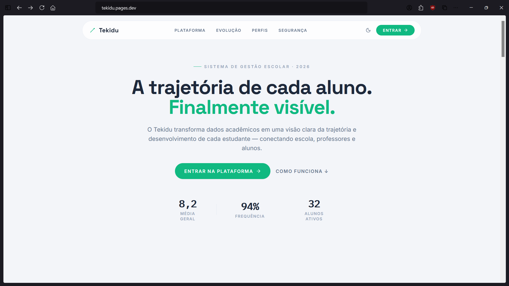
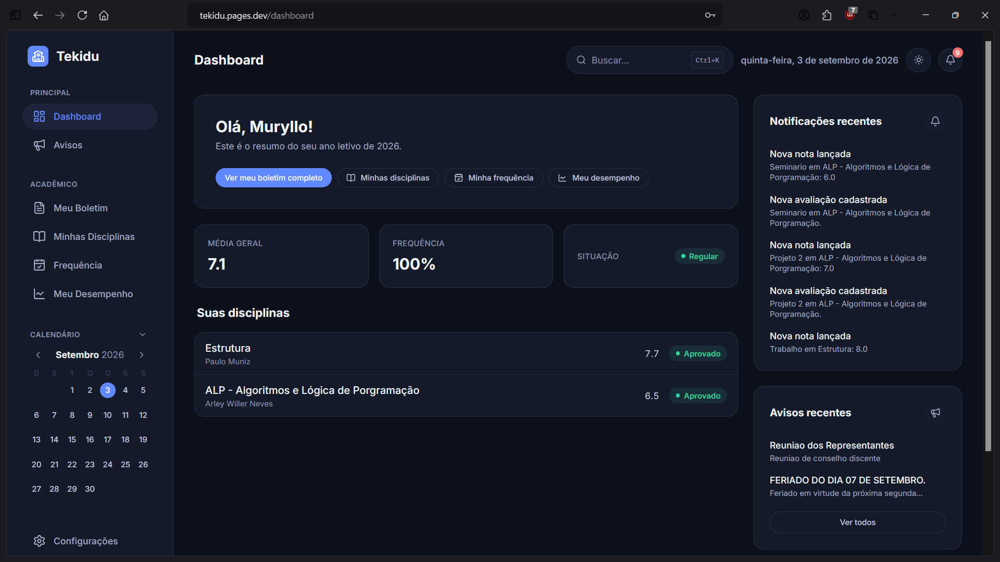

# Tekidu — gestão e acompanhamento acadêmico

Notas, frequência, boletim, turmas e comunicados costumam ficar em planilhas e sistemas separados. O Tekidu reúne tudo em um ambiente com quatro experiências distintas: **administrador**, **professor**, **estudante** e **responsável (somente leitura)**.

[Aplicação](https://tekidu.pages.dev/) · [Estudo de caso](https://portfolio-c1u.pages.dev/projects/tekidu)

  
  

## Perfis

| Perfil | Acesso |
| --- | --- |
| Administrador | Gestão de turmas, usuários, avisos e calendário; relatórios; log de auditoria |
| Professor | Lançamento de notas e frequência por sessão; avisos; relatórios das suas turmas |
| Estudante | Notas, médias, boletim, frequência, justificativas de falta, avisos e calendário |
| Responsável | Acompanhamento do estudante em **somente leitura** |

## Recursos

- Autenticação com Firebase: login, primeiro acesso com e-mail transacional e recuperação de senha.
- Notas, médias, boletim e frequência por sessão.
- Justificativas de falta com documento comprobatório.
- Exportação do boletim em **PDF** e de frequência e relatórios em **Excel/PDF**.
- Avisos e calendário acadêmico.
- **PWA instalável**.
- **Painel de acessibilidade**, modo escuro e navegação mobile dedicada.
- Páginas carregadas sob demanda por perfil (`React.lazy`), para que um perfil não baixe o código de outro.
- Log de auditoria assíncrono para alterações sensíveis.

## Segurança

A autorização é aplicada nas **Firestore Security Rules**, não apenas escondida na interface. Há uma suíte própria de testes (Vitest + Firebase Emulator) cobrindo acessos permitidos e negados, inclusive o acesso somente leitura do responsável.

## Stack

React 18 · TypeScript · Vite · Tailwind CSS · Framer Motion · Firebase Auth · Cloud Firestore · Cloudflare Pages Functions (envio de e-mail) · Vitest

## Estado

Em desenvolvimento. Ainda **pendentes**:

- [ ] Pipeline de CI/CD
- [ ] Testes de componentes de interface
- [ ] Monitoramento de erros em produção
- [ ] Auditoria de acessibilidade
